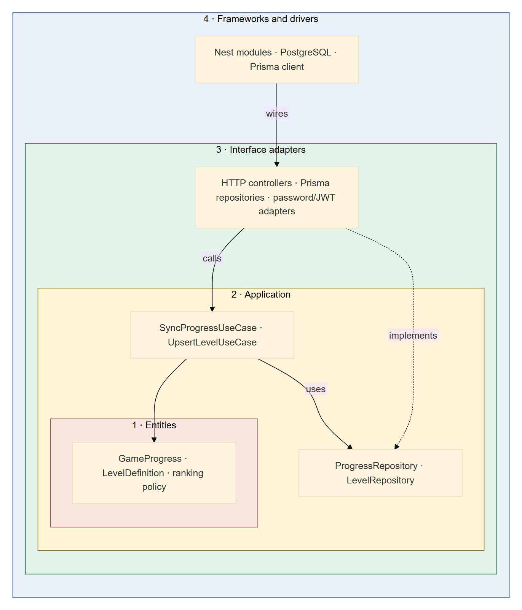
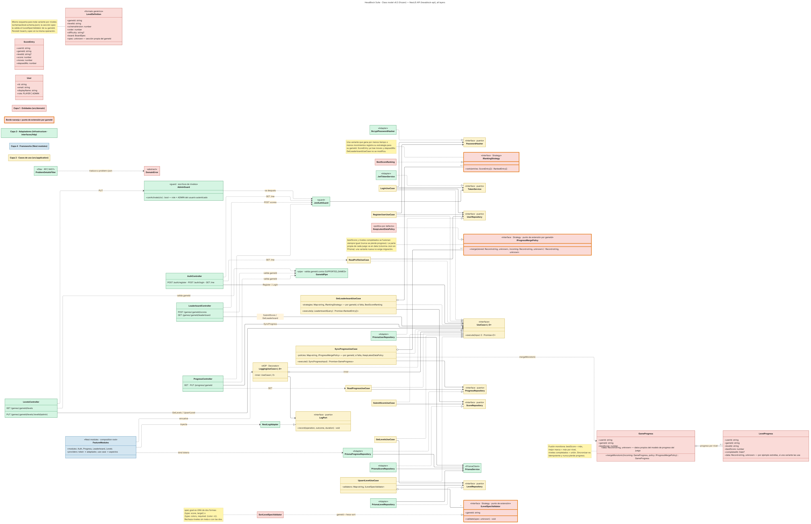

# HexaBlock Suite · REST API


NestJS, Prisma and PostgreSQL form the backend for the [HexaBlock mobile client](https://github.com/hexablock-g5-ucab/hexablock-app). The target API manages accounts, progress, rankings and downloadable Sort levels.

**Development status.** The starter exposes a root route, a Prisma data model and unit/HTTP smoke tests. Authentication, game endpoints, OpenAPI and the first committed migration are implementation milestones. [Assessment scope](docs/specs/requirements.md)

## Getting started

Use Node.js 24, npm and Docker with Compose. From the API checkout, copy the example environment file, set the local development values, then start the service. On PowerShell:

```powershell
Copy-Item .env.example .env
npm install
docker compose up -d db
npm run start:dev
```

On macOS or Linux use `cp .env.example .env` for the first step. The [local root route](http://localhost:3000/) runs the starter smoke check. The first database feature should commit the reviewed migration and dependency lockfile before CI switches to `npm ci`.

## Architecture and class model

Application code defines use cases and repository ports. Nest modules wire controllers, credential adapters and Prisma repositories. Adapters translate persistence rows and HTTP DTOs at the boundary.



[Editable source](docs/diagrams/clean-architecture.mmd)

The complete class model of the API in one picture (model v6.3), all four Clean Architecture layers.
Colours mark the layer: red = Entities (`src/domain`), yellow = Use cases (`src/application`),
green = Interface adapters (`src/infrastructure`, `src/interfaces/http`), blue = Frameworks (Nest modules).
An orange border marks an extension point per `gameId`.

[](docs/diagrams/class-diagram-api.svg)

Click the image for the zoomable SVG. Source: [`class-diagram-api.mmd`](docs/diagrams/class-diagram-api.mmd).
The client model lives in [hexablock-app](https://github.com/hexablock-g5-ucab/hexablock-app#class-model).

[Model decisions and contract checks](docs/diagrams/README.md)

## Generic engine and HTTP contract

The [client engine](https://github.com/hexablock-g5-ucab/hexablock-app) owns game rules. The server keys progress and rankings by game ID, with an optional level filter for Sort. A [level envelope](schemas/level.schema.json) carries schemaVersion, gameId, levelId, order, board and game-specific spec. The existing schema also recognizes historical Fit definitions. Sort is the assessed level catalogue.

| Planned feature | HTTP contract |
| --- | --- |
| Accounts | POST /auth/register, POST /auth/login, GET /me |
| Personal progress | GET and PUT /progress/{gameId} for the authenticated player |
| Scores and rankings | POST /games/{gameId}/scores, GET /games/{gameId}/leaderboard with optional levelId |
| Sort level catalogue | GET /games/{gameId}/levels, admin PUT /games/{gameId}/levels/{levelId} |
| API exploration | Swagger UI at /api/docs when configured |

Progress sync keeps the best score and the union of completed levels, and merges each game's own JSON data with a per-game policy. Scores carry moves and elapsed time so each game can rank by its own strategy. A published Sort level must retain its board and spec through PostgreSQL. [Progress use case](docs/specs/use-cases/UC-101-sync-progress.md) · [Prisma model](prisma/schema.prisma)

## Design patterns, SOLID and AOP

The [UseCase contract](src/application/use-cases/use-case.ts) and [logging decorator](src/application/aspects/logging.use-case.ts) exist. The decorator times its wrapped use case and propagates results and exceptions. Connecting it to game operations and moving its Nest logger behind a port remain implementation work.

The model separates HTTP mapping from progress merging (SRP), registers level validators by game ID (OCP), preserves use-case behaviour through logging (LSP), splits repository ports by feature (ISP) and injects them into use cases (DIP). Add a code example and test for each principle as the corresponding feature lands.

When composing a traced use case, pass its operation, fixed name and a `NestLogAdapter` to `LoggingUseCase`. The port records operation, outcome and elapsed milliseconds.

## Running tests

```sh
npm run lint
npm test
npm run test:e2e
npm run build
```

[CI](.github/workflows/ci.yml) starts PostgreSQL. The starter HTTP test calls the root route. Database-backed tests should cover repeated progress updates, isolation by user and game, authorization for level updates and level publication.

## AI usage, contributing and license

Record assistance in [AI_USAGE.md](AI_USAGE.md). Follow [CONTRIBUTING.md](CONTRIBUTING.md) for English Conventional Commits and the PR workflow. [MIT license](LICENSE).
